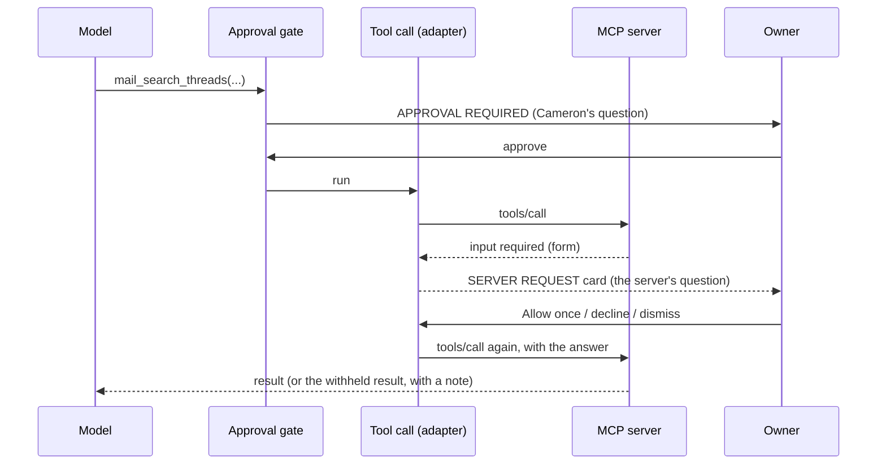

# MCP elicitation: a server asking the owner

A connected MCP server can stop in the middle of a tool call and ask a question (MCP
**elicitation**). Some hosted servers use it to protect data: a mail server asks "allow this agent
to read these 3 messages?" before it returns them. A client that can't answer gets an
empty-looking success with the content withheld, which the agent reads as "nothing found" (#87).

Cameron answers these questions through the owner, in the thread, on a card next to the
approval card.

## How a question reaches the owner

- **Two questions, two owners.** Cameron's approval gate runs before the call. The server's
  question comes during it, from the server, and only the server knows what it means. The card
  says whose question it is.
- **The adapter does the protocol.** `toServerConfig` sets `elicitation: true`, so
  `@langchain/mcp-adapters` lets a call return "input required" and raises a LangGraph
  interrupt `{ type: "mcp_elicitation", server, tool, arguments, requests }` inside the tool
  call. On resume it sends the call again from the start with the answer attached, so a server
  that does work before asking repeats it once per round.
- **Newer-protocol servers only.** This is the 2026-07-28 protocol's in-band elicitation. A
  server that negotiates the older protocol is never told Cameron can elicit, so it behaves as
  before. Supporting it would mean holding the server's request open while the owner answers,
  which survives neither a restart nor a scheduled task.

## The pieces

| File                                 | Role                                                                   |
| ------------------------------------ | ---------------------------------------------------------------------- |
| `src/lib/mcp/elicitation.ts`         | Zero-import leaf: types, which input a field renders as, answer checks |
| `src/services/elicitationAnswers.ts` | Reads pending questions, matches them to calls, builds the resume      |
| `src/lib/agent/elicitationNotes.ts`  | Adds a note to a result whose question the owner declined or dismissed |
| `src/services/messageStream.ts`      | Sends the `pendingElicitations` marker once the run settles            |
| `src/components/ElicitationCard.tsx` | The card                                                               |

- **Matching.** The interrupt carries no tool call id, so `readPendingElicitations` matches it to
  an unanswered call on the last AI message by `server_tool` name and arguments, then by name.
  The match only places the card; the resume is addressed by interrupt id.
- **Not an approval.** A call paused this way also never executed, which is the stream's
  approval signal. `streamMessages` therefore reads the questions from the graph state when the
  run settles, leaves their calls out of `pendingToolCallIds`, and sends them as their own marker
  chunk. langchain settles a still-suspended call with no output at the end of the run, so a
  result with `undefined` output is not sent (it would close the call and hide the card).
- **Answers are checked before resuming.** `resolveElicitationAnswers` refuses a missing,
  unknown or invalid answer and nothing resumes, like `resolveDecisions`. The adapter would fail
  the whole call on an answer its schema rejects; here the owner just gets the form back.
- **Resume.** `GET /api/agent/stream?answers=` carries
  `{ [interruptId]: { [requestKey]: { action, content? } } }`. It is mutually exclusive with
  `decisions`: an approval pauses before the tools run and a question during, so both are never
  pending at once.

## Declined and dismissed

The server decides what a declined call returns, and a mail server returns the same withheld
result as a client that can't elicit. So the resume passes the owner's choice per call id in the
run's `configurable` (`ELICITATION_OUTCOMES_KEY`), and `elicitationNoteMiddleware` appends a
`[cameron]` note to that result: the content may be withheld, and an empty result does not mean
nothing matched. The thread never hangs: decline and dismiss resume like accept.

## The card

- The server's message is untrusted text: it can quote an email subject. Only `**bold**` is
  rendered; never links, images or HTML. A URL request shows its link for the owner to open;
  nothing opens on its own.
- A form whose only field is a single choice shows each choice as a button that answers at once
  (labels from `enumNames` or `oneOf` titles). Any other form renders its fields and a Send button.
- **decline** and **dismiss** are the protocol's `decline` and `cancel`.
- A choice like "Always allow this tool" is kept by the server, not by Cameron, and the card says
  so. Cameron's approval gate still applies to every call.

## No one there to answer

- **Scheduled tasks**: a grant skips Cameron's approval gate, never a server's question. A run
  that hits one pauses with reason `server_request`, and `/tasks` lists it under "Waiting for
  you". The owner answers in the thread as usual. What lets a granted tool run unattended is the
  server's own "always allow", if it offers one.
- **Evals**: the runner declines every question (`declineAll`) through the same resolver, so a
  case never ends paused on one.
