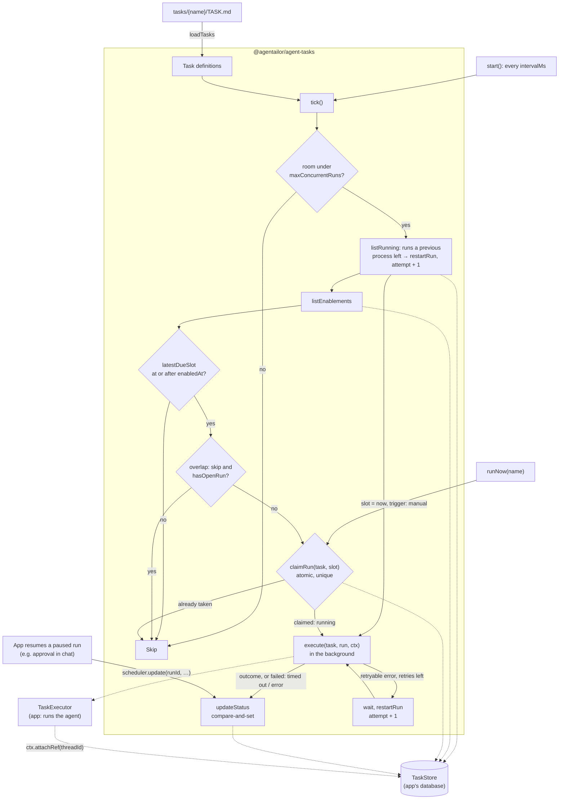
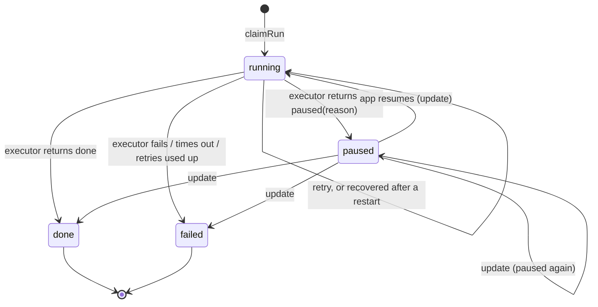

# @agentailor/agent-tasks

Scheduled tasks for an agent: task files, cron slots, a run lifecycle and a scheduler loop. It
knows nothing about the agent, the database or the approval gate. The caller supplies a
`TaskStore` (persistence) and a `TaskExecutor` (what running a task means).

Internal workspace package; ships TypeScript source. Depends only on `cron-parser` and `yaml`.

```ts
import { createScheduler, loadTasks } from "@agentailor/agent-tasks";

const { tasks, failures } = loadTasks("tasks"); // tasks/<name>/TASK.md
const scheduler = createScheduler({
  tasks,
  store, // your TaskStore over your database
  defaultTimezone: "Europe/Paris",
  policy: (name) => overridesFor(name), // optional, e.g. { timeoutMs: 5 * 60_000 }
  maxConcurrentRuns: () => ownerLimit(), // optional, default 3
  isRetryable: (error) => !isPermanent(error), // optional, default: every error
  execute: async (task, run, ctx) => {
    // ctx.previousRef is set on a retry or after a restart: continue from it, or start over.
    const threadId = ctx.previousRef ?? (await startThread(task.brief, { signal: ctx.signal }));
    await ctx.attachRef(threadId);
    return (await isPaused(threadId))
      ? { status: "paused", reason: "approval" }
      : { status: "done" };
  },
});
scheduler.start();
```

A task file:

```md
---
name: weekly-digest
description: A summary of last week's spending.
schedule: "0 8 * * MON"
timezone: Europe/Paris
---

The brief the agent is given.
```

## How it works

The package owns everything inside the box. The app plugs in the store and the executor, and
resumes paused runs on its own path.



A run's status:



## Rules it enforces

- **A slot runs at most once.** `claimRun` must be atomic on `(taskName, slot)`, a unique key in
  a database. That alone stops double runs, across ticks and across processes, so there is no lock.
- **Only the latest due slot runs.** After an outage the task catches up once, not once per
  missed slot, and never for a slot before the owner enabled it (`enabledAt`).
- **Runs are `running → paused | done | failed`.** `done` and `failed` are final. A paused run
  is resumed by the app, never by the package; the app records it with `scheduler.update`.
  Every status write is compare-and-set (`updateStatus(id, from, write)`).
- **Executors run in the background.** `tick()` returns the runs it started; `idle()` waits for
  them. A `ref` attached early is kept whatever happens next.

## Limits and failures

Each task runs under a `TaskPolicy`: `DEFAULT_TASK_POLICY` merged with whatever `policy(name)`
returns (an `undefined` value keeps the default). Policies and `maxConcurrentRuns` are read when
they're needed, so the app can change them without a restart.

| Setting             | Default | Effect                                                                     |
| ------------------- | ------- | -------------------------------------------------------------------------- |
| `timeoutMs`         | 10 min  | `ctx.signal` aborts and the run fails: "Timed out after 10 min." No retry. |
| `maxRetries`        | 1       | Extra attempts after a thrown error that `isRetryable` accepts.            |
| `overlap`           | `skip`  | A slot isn't started while the task has a run `running` or `paused`.       |
| `maxConcurrentRuns` | 3       | Global, per process. Due slots past it start on a later tick.              |

- **The executor must honour `ctx.signal`.** One that ignores it is abandoned: its run is failed,
  and whatever it returns later is dropped.
- **Retries wait** `retryDelayMs` × the attempt number (default 30 s), then `restartRun` and call
  the executor again with `attempt` + 1 and `previousRef`.
- **`stop(graceMs)`** stops ticking, waits up to `graceMs` (default 10 s), then aborts what is
  left. An aborted run stays `running`.
- **Recovery:** a `running` run that started before this scheduler was created was left by a
  previous process. A tick takes it over with `restartRun` (compare-and-set on `startedAt`, so
  only one scheduler wins) and calls the executor with `previousRef`. If its task file is gone, it
  fails. This assumes **one scheduler process per store**: with two live processes, one could
  take over a run the other is still executing.
- **`runNow`** returns `busy` at the concurrency limit, and ignores `overlap`.
- **Task files are strict.** The frontmatter keys are a closed set, values must be strings, the
  name must equal its directory, the schedule has five fields (ticks are a minute apart) and the
  body (the brief) can't be empty. A missing `tasks/` directory loads nothing silently; a broken
  task is returned in `failures`.

## Files

- `types.ts`: task, run, outcome, `TaskStore`, `TaskExecutor`
- `taskFile.ts`: parse and validate one `TASK.md`
- `loader.ts`: read a tasks directory
- `schedule.ts`: cron validation, latest due slot, next slot
- `lifecycle.ts`: allowed transitions and the status write for each
- `scheduler.ts`: the loop, policies, timeouts, retries, recovery, `runNow`, `update`
- `testing.ts`: `MemoryTaskStore`, `FakeClock`, `makeTask`, exported as `@agentailor/agent-tasks/testing` (tests only)
