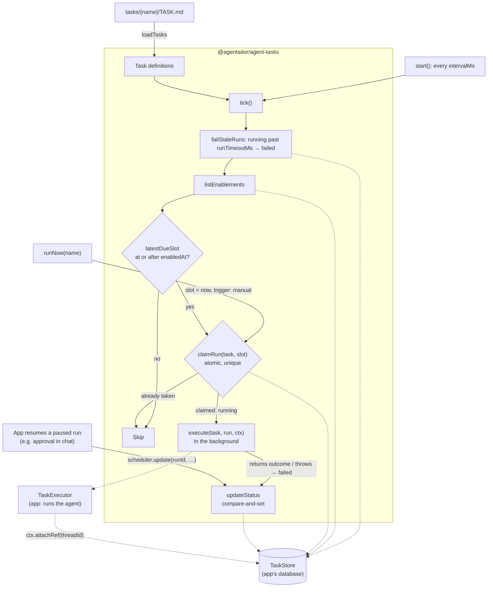
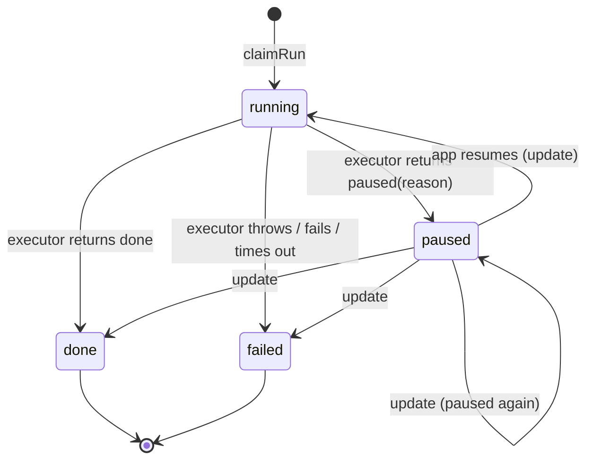

# @agentailor/agent-tasks

Scheduled tasks for an agent: task files, cron slots, a run lifecycle and a scheduler loop. It
knows nothing about the agent, the database or the approval gate. The caller supplies a
`TaskStore` (persistence) and a `TaskExecutor` (what running a task means).

Internal workspace package; ships TypeScript source. Depends only on `cron-parser` and `yaml`.

```ts
import { createScheduler, loadTasks } from "@agentailor/agent-tasks";

const { tasks, failures } = loadTasks("tasks"); // tasks/<name>/TASK.md
const scheduler = createScheduler({
  tasks,
  store, // your TaskStore over your database
  defaultTimezone: "Europe/Paris",
  execute: async (task, run, ctx) => {
    const threadId = await startThread(task.brief);
    await ctx.attachRef(threadId);
    return (await isPaused(threadId))
      ? { status: "paused", reason: "approval" }
      : { status: "done" };
  },
});
scheduler.start();
```

A task file:

```md
---
name: weekly-digest
description: A summary of last week's spending.
schedule: "0 8 * * MON"
timezone: Europe/Paris
---

The brief the agent is given.
```

## How it works

The package owns everything inside the box. The app plugs in the store and the executor, and
resumes paused runs on its own path.



A run's status:



## Rules it enforces

- **A slot runs at most once.** `claimRun` must be atomic on `(taskName, slot)`, a unique key in
  a database. That alone stops double runs, across ticks and across processes, so there is no lock.
- **Only the latest due slot runs.** After an outage the task catches up once, not once per
  missed slot, and never for a slot before the owner enabled it (`enabledAt`).
- **Runs are `running → paused | done | failed`.** `done` and `failed` are final. A paused run
  is resumed by the app, never by the package; the app records it with `scheduler.update`.
  Every status write is compare-and-set (`updateStatus(id, from, write)`).
- **A run still `running` after `runTimeoutMs`** (default 30 min) is failed as stale. That
  covers a process that died mid-run.
- **Executors run in the background.** `tick()` returns the runs it started; `idle()` and `stop()`
  wait for them. A throwing executor fails its run; a `ref` attached first is kept.
- **Task files are strict.** The frontmatter keys are a closed set, values must be strings, the
  name must equal its directory, the schedule has five fields (ticks are a minute apart) and the
  body (the brief) can't be empty. A missing `tasks/` directory loads nothing silently; a broken
  task is returned in `failures`.

## Files

- `types.ts`: task, run, outcome, `TaskStore`, `TaskExecutor`
- `taskFile.ts`: parse and validate one `TASK.md`
- `loader.ts`: read a tasks directory
- `schedule.ts`: cron validation, latest due slot, next slot
- `lifecycle.ts`: allowed transitions and the status write for each
- `scheduler.ts`: the loop, `runNow`, `update`
- `testing.ts`: `MemoryTaskStore`, `FakeClock`, `makeTask`, exported as `@agentailor/agent-tasks/testing` (tests only)
